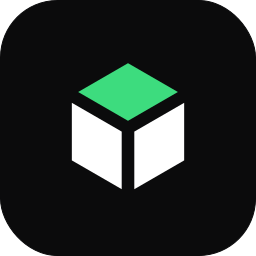

# 🚀 MineBAO | Bot Always Online

<p align="center">
  
</p>

<p align="center">
  <b>B</b>ot &bull; <b>A</b>lways &bull; <b>O</b>nline
</p>

<p align="center">
  
  
  
  
  
  
  
</p>

---

**MineBAO** (**B**ot **A**lways **O**nline) es un launcher y gestor integral de Minecraft para escritorio desarrollado con **Electron**. Está diseñado pensando tanto en jugadores como en administradores y entusiastas de la automatización en entornos **offline / no premium**:

1. **🎮 Launcher Java Completo:** Descarga, verifica y ejecuta versiones oficiales **Vanilla** y perfiles optimizados **Fabric** con soporte de mods sin necesidad de launchers pesados o cuentas Microsoft.
2. **🤖 Modo NoGUI / Bot Always Online:** Cliente autónomo impulsado por **Mineflayer** concebido para mantener cuentas activas 24/7 (granjas AFK, cargadores de chunks, bots de soporte) sin consumir memoria gráfica ni abrir la ventana de Minecraft.
3. **📊 Dashboard Web Local en Vivo:** Servidor WebSocket interno (`ws://localhost:3000`) y panel web con telemetría en tiempo real: salud, comida, ping, coordenadas 3D, chat con formato de colores original de Minecraft e interacción con menús de inventario.
4. **💬 Discord Rich Presence:** Muestra en tu perfil de Discord en tiempo real qué versión estás jugando, en qué servidor te encuentras y el tiempo transcurrido.

---

## 📑 Tabla de Contenidos

- [✨ Características Principales](#-características-principales)
- [🎨 Identidad Visual y Logos](#-identidad-visual-y-logos)
- [📋 Requisitos del Sistema](#-requisitos-del-sistema)
- [📥 Instalación y Ejecución](#-instalación-y-ejecución)
- [📦 Compilación y Creación de Instaladores](#-compilación-y-creación-de-instaladores)
- [💡 Ejemplos de Uso](#-ejemplos-de-uso)
  - [1. Lanzar Minecraft en modo Jugador (GUI)](#1-lanzar-minecraft-en-modo-jugador-gui)
  - [2. Modo Automatizado AFK / Bot (NoGUI)](#2-modo-automatizado-afk--bot-nogui)
  - [3. Dashboard Web Local](#3-dashboard-web-local)
- [⚙️ Guía de Configuración](#️-guía-de-configuración)
  - [Configuración Global (`config.json`)](#configuración-global-configjson)
  - [Configuración de Perfiles (`profiles.json`)](#configuración-de-perfiles-profilesjson)
  - [Filtro de Chat (`config/ignore.json`)](#filtro-de-chat-configignorejson)
- [🏗️ Arquitectura y Estructura del Código](#️-arquitectura-y-estructura-del-código)
- [❓ Preguntas Frecuentes y Solución de Problemas](#-preguntas-frecuentes-y-solución-de-problemas)
- [👥 Créditos y Licencia](#-créditos-y-licencia)

---

## ✨ Características Principales

| Característica | Detalle |
|---|---|
| 🎮 **Gestión de Versiones** | Descarga e instalación desatendida de versiones Vanilla y Fabric directo de los manifiestos oficiales de Mojang y FabricMC, con verificación de integridad SHA1 de librerías y assets. |
| ☕ **Detección Inteligente de Java** | Analiza automáticamente los JDKs instalados en el sistema y selecciona la versión adecuada (Java 8, Java 17, Java 21) según los requisitos de cada versión de Minecraft. |
| 🤖 **Bot Always Online (Mineflayer)** | Conexión directa a servidores en modo texto para dejar cuentas AFK sin abrir Minecraft. Incluye compatibilidad avanzada con proxies **Velocity** y **BungeeCord**. |
| 🔄 **Auto-Reconexión Inteligente** | Reconexión automática con backoff exponencial, jitter y ventana de recuperación de autenticación para servidores inestables. |
| 📊 **Dashboard y WebSocket en Vivo** | Servidor WebSocket local integrado (`ws://localhost:3000`) que expone estadísticas vitales (salud, comida, coordenadas, ping, inventario) y chat formateado. |
| 💬 **Discord Rich Presence** | Integración nativa con Discord RPC mostrando estado, servidor, versión y marca de tiempo con identidad MineBAO. |
| 🎨 **UI Moderna e Inmersiva** | Interfaz con fondos de video cinemáticos dinámicos (1080p, 2K, 4K), música ambiental y navegación por teclado estilo consola. |
| ⚡ **Perfiles de Rendimiento** | Asignación configurable de memoria RAM mínima y máxima (`-Xms`, `-Xmx`), argumentos de JVM optimizados e instancias dedicadas. |

---

## 🎨 Identidad Visual y Logos

El proyecto cuenta con identidad visual propia situada en `assets/logo/`:

- **Icono Principal:** `MineBAO-icono-256-oscuro.png` / `.svg` (Bloque isométrico con tapa esmeralda `#3DDC7E` y base oscura `#0B0B0C`).
- **Símbolo de Marca:** `MineBAO-simbolo-256-color.png` / `.svg`.
- **Variantes Disponibles:** Versiones en claro, oscuro, blanco, negro y color para diversos contextos y fondos.
- **Icono de Ejecutable:** `icon.ico` / `MineBAO.ico` (multi-resolución para instaladores y ventana de Windows).

---

## 📋 Requisitos del Sistema

### Para Desarrollo y Ejecución
- **Sistema Operativo:** Windows 10 / 11 (64-bit).
- **Node.js:** Versión `18.x` o superior (compatible con `v16.x` hasta `v22.x`). Se recomienda LTS.
- **npm:** Versión `9.x` o superior (incluido con Node.js).
- **Git:** Para clonar el repositorio.

### Para el Lanzamiento del Juego (Modo GUI)
- **Java Runtime Environment (JRE) / JDK:**
  - **Java 8 (1.8):** Minecraft 1.12.2 y anteriores.
  - **Java 16 / 17:** Minecraft 1.17 hasta 1.20.4.
  - **Java 21:** Minecraft 1.20.5 y versiones superiores (1.21+).
  > [!TIP]
  > Se recomienda descargar e instalar los runtimes de [Eclipse Adoptium (Temurin)](https://adoptium.net/). El launcher es capaz de autodetectar su ruta si están instalados en `Program Files\Eclipse Adoptium`.

> [!NOTE]
> Para utilizar únicamente el **Modo NoGUI (Bot Always Online / Mineflayer)** no necesitas Java instalado; corre íntegramente sobre Node.js.

---

## 📥 Instalación y Ejecución

Sigue estos pasos para clonar y ejecutar el launcher en entorno de desarrollo:

### 1. Clonar el Repositorio
```bash
git clone https://github.com/vC3sar/MineBAO.git
cd MineBAO
```

### 2. Instalar Dependencias
```bash
npm install
```

### 3. Configurar Parámetros Iniciales (Opcional)
Edita `config.json` si deseas personalizar el `clientId` de Discord o asignar una ruta fija para tu ejecutable de Java:
```json
{
  "clientId": "1410394282841342055",
  "launcher": {
    "downloads": {
      "minMemoryMb": 1024,
      "maxMemoryMb": 4096
    }
  }
}
```

### 4. Iniciar en Modo Desarrollo
```bash
npm start
```
*O alternativamente:*
```bash
npm run dev
```

---

## 📦 Compilación y Creación de Instaladores

El proyecto utiliza **`electron-builder`** para empaquetar y generar ejecutables de distribución listos para producción.

### Comandos de Compilación Disponibles

| Comando | Acción | Salida |
|---|---|---|
| `npm run pack` | Empaqueta la app sin crear el instalador (para pruebas rápidas de build). | Directorio `dist/win-unpacked/` |
| `npm run build` | Compila la aplicación según la configuración de `package.json`. | Directorio `dist/` |
| `npm run build:win` | Genera el instalador estándar de Windows de 64 bits en formato NSIS (`.exe`). | `dist/MineBAO-1.1.0-win-x64.exe` |

### Pasos para compilar el instalador para Windows:
1. Asegúrate de que las dependencias estén instaladas:
   ```bash
   npm install
   ```
2. Ejecuta la compilación de Windows:
   ```bash
   npm run build:win
   ```
3. Una vez finalizado el proceso, encontrarás el instalador en la carpeta `dist/`:
   ```
   dist/
   ├── MineBAO-1.1.0-win-x64.exe     <-- Instalador distribuible NSIS
   ├── builder-effective-config.yaml
   └── win-unpacked/                 <-- Binarios descomprimidos ejecutables
       └── MineBAO.exe
   ```

> [!NOTE]
> El instalador generado cuenta con asistente de instalación NSIS que permite:
> - Instalar sin permisos de administrador (modo por usuario).
> - Elegir la ruta de instalación personalizada.
> - Crear accesos directos en el Escritorio y Menú Inicio con el icono oficial de MineBAO.

---

## 💡 Ejemplos de Uso

### 1. Lanzar Minecraft en modo Jugador (GUI)

Este modo descarga los archivos de Minecraft oficiales, monta el entorno y ejecuta el juego:

1. Inicia el launcher (`npm start` o ejecuta `MineBAO.exe`).
2. En la pantalla principal:
   - Selecciona el motor de juego: **Vanilla** o **Fabric**.
   - Elige la versión deseada en la lista desplegable (ejemplo: `1.21.1` o `1.20.4`).
   - Ingresa tu **Nombre de usuario offline** (ej. `AlexGamer`).
3. Haz clic en el botón **Play**:
   - Si la versión no está instalada, el launcher descargará automáticamente el manifiesto, el `client.jar`, las librerías nativas y los assets desde los servidores de Mojang.
   - Si seleccionaste Fabric, descargará el loader y configurará el perfil correspondiente.
   - La barra de estado te informará del progreso en porcentaje (`Descargando librerías 45%...`).
4. Minecraft abrirá con la memoria asignada y Discord mostrará tu actividad con el estado de MineBAO.

---

### 2. Modo Automatizado AFK / Bot (NoGUI)

Ideal para conectarte a tu servidor Survival, skyblock o granja sin abrir Minecraft:

1. En el launcher, selecciona el modo **Bot rápido (NoGUI)**.
2. Ingresa los datos de conexión:
   - **Usuario:** Nombre con el que entrará el bot (ej. `GranjaBot`).
   - **IP del Servidor:** Dirección del servidor (ej. `mc.miservidor.com`).
   - **Puerto:** Puerto del servidor (por defecto `25565`).
   - **Versión:** Versión del protocolo de Minecraft (ej. `1.21.11`).
3. Pulsa **Iniciar nueva partida**.
4. La consola del launcher mostrará el proceso de autenticación e ingreso al mundo. Si el servidor se reinicia, el algoritmo de reconexión de MineBAO reintentará la conexión automáticamente.

---

### 3. Dashboard Web Local

Durante una sesión en modo bot, MineBAO levanta un servidor de telemetría:

1. Abre tu navegador web en:
   ```
   http://localhost:3000
   ```
   *(o interactúa con la pestaña interna `app.html` del launcher)*
2. Tendrás acceso a:
   - **Chat en vivo:** Mensajes de jugadores con colores originales decodificados.
   - **Barra de vida y hambre:** Monitoreo de supervivencia.
   - **Posición X, Y, Z y Ping:** Coordenadas en tiempo real y latencia con el servidor.
   - **Interacción con menús:** Capacidad de responder a menús tipo inventario (GUI/Chest menus) del servidor.

---

## ⚙️ Guía de Configuración

### Configuración Global (`config.json`)

El archivo [config.json](file:///c:/Users/vCesar/OneDrive/Escritorio/Proyectos/MC-BETA/config.json) contiene las preferencias de la aplicación y del motor de juego:

```json
{
  "clientId": "1410394282841342055",
  "launcher": {
    "preferredVersions": [
      "1.21.11"
    ],
    "velocityCompatMode": true,
    "debugLifecycle": true,
    "verboseMode": "all",
    "reconnectDelayMs": 650,
    "authRecoveryWindowMs": 30000,
    "maxReconnectAttempts": 6,
    "reconnectBackoffMaxMs": 4000,
    "reconnectJitterRatio": 0.2,
    "menuBackgroundMode": "auto",
    "language": "es",
    "catalogCache": {
      "ttlMs": 21600000
    },
    "downloads": {
      "minecraftDir": "",
      "javaPath": "C:\\Program Files\\Eclipse Adoptium\\jdk-21.0.8.9-hotspot\\bin\\javaw.exe",
      "minMemoryMb": 1024,
      "maxMemoryMb": 4096,
      "extraJvmArgs": "-XX:+UseG1GC -XX:+ParallelRefProcEnabled",
      "extraGameArgs": "",
      "performanceProfileId": "fabric_performance_v1",
      "instanceMode": "dedicated"
    }
  }
}
```

#### Parámetros Clave:
- **`clientId`**: ID de la aplicación de Discord para Rich Presence.
- **`velocityCompatMode`**: Habilita compatibilidad con proxies Velocity/BungeeCord para evitar desconexiones de handshake.
- **`downloads.javaPath`**: Ruta absoluta al ejecutable `javaw.exe` (dejar vacío para autodetección).
- **`downloads.minMemoryMb` / `maxMemoryMb`**: RAM mínima y máxima en megabytes para la JVM de Minecraft (`-Xms` y `-Xmx`).
- **`downloads.extraJvmArgs`**: Banderas adicionales para optimización de recolección de basura (GC) o argumentos personalizados.
- **`reconnectDelayMs` / `maxReconnectAttempts`**: Control del sistema anti-desconexión del bot.

---

### Configuración de Perfiles (`profiles.json`)

El archivo [profiles.json](file:///c:/Users/vCesar/OneDrive/Escritorio/Proyectos/MC-BETA/profiles.json) almacena la última sesión configurada para que no tengas que reescribir tus credenciales:

```json
{
  "username": "TuNick",
  "ip": "mc.servidor.com",
  "port": 25565,
  "version": "1.21.11",
  "mode": "nogui"
}
```

---

### Filtro de Chat (`config/ignore.json`)

Permite filtrar mensajes molestos o spam del servidor para mantener limpio el terminal del bot:

```json
{
  "words": [
    "bienvenido al servidor",
    "vota con /vote",
    "anuncio del servidor"
  ]
}
```

---

## 🏗️ Arquitectura y Estructura del Código

```
MineBAO/
├── assets/                  # Identidad gráfica oficial
│   └── logo/                # Logos e iconos en PNG, SVG e ICO
├── icon.ico & icon.png      # Iconos de aplicación y binario ejecutable
├── main.js                  # Proceso principal de Electron y ciclo de vida de la app
├── preload.js               # ContextBridge seguro entre Node.js y Renderer
├── minelight.js             # Módulo de orquestación de Mineflayer y servidor WebSocket
├── config.json              # Configuración persistente del launcher y JVM
├── profiles.json            # Último perfil de usuario / servidor guardado
├── package.json             # Manifiesto npm, dependencias y configuración de compilación
│
├── src/                     # Núcleo del sistema
│   ├── game-launcher.js     # Gestor de instalación, descarga y ejecución de Minecraft
│   ├── game-launcher/       # Constantes de APIs (Mojang/Fabric) y resolución de Java
│   │   ├── constants.js
│   │   └── version-java.js
│   ├── main/                # Lógica del proceso principal de Electron
│   │   ├── bot.js           # Gestión de sesiones del bot Mineflayer
│   │   ├── config.js        # Carga, fusión de valores por defecto y guardado
│   │   ├── ipc.js           # Enrutamiento de llamadas IPC Renderer <-> Main
│   │   ├── utils.js         # Utilidades de red, parsing y validación
│   │   └── window.js        # Creación y configuración de BrowserWindow con icono
│   └── bot/                 # Componentes del bot Mineflayer
│       ├── bot-lifecycle.js # Manejo de spawn, desconexión y auto-reconexión
│       ├── chat.js          # Procesamiento y desinfección de mensajes del chat
│       ├── vitals.js        # Extracción de vida, hambre, ping y coordenadas
│       ├── menu.js          # Control de inventarios interactivos del juego
│       └── ws-server.js     # Servidor de WebSocket para telemetría
│
├── js/                      # Scripts de la interfaz de usuario (Renderer)
│   ├── shared/              # Diccionarios i18n y utilidades compartidas
│   └── launcher/            # Navegación por teclado, catálogo, audio y acciones
│
├── css/                     # Estilos modulares del launcher
│   ├── shared.css           # Variables de diseño, fuentes y paletas de color
│   ├── app.css              # Estilos del dashboard con badge MineBAO
│   └── main/                # Formularios, botones, modales y vista de estado
│
├── fn/                      # Módulos auxiliares
│   └── discord.js           # Integración con la librería discord-rpc (MineBAO RPC)
│
├── mp3/ & mp4/              # Assets multimedia (música ambiental y videos de fondo)
└── dist/                    # Directorio de salida de compilaciones (instaladores .exe)
```

---

## ❓ Preguntas Frecuentes y Solución de Problemas

### 1. El juego no inicia y marca error relacionado con Java
- **Causa:** La versión de Minecraft seleccionada requiere un JDK diferente al que tienes instalado por defecto en el `PATH` del sistema.
- **Solución:** Instala la versión de Java requerida (por ejemplo [Temurin 21](https://adoptium.net/) para Minecraft 1.20.5+ o [Temurin 17](https://adoptium.net/) para 1.18-1.20.4) y verifica que la opción de autodetectar en `config.json` esté activa o ingresa la ruta completa a `javaw.exe` en `"downloads.javaPath"`.

### 2. No aparece el estado en Discord (Rich Presence)
- **Causa:** Discord no está abierto o el Client ID configurado no tiene los assets registrados.
- **Solución:**
  1. Abre Discord antes de iniciar el launcher.
  2. Verifica que en `config.json` el campo `clientId` tenga un ID válido.
  3. Si creas tu propia Discord App, asegúrate de registrar los assets con los nombres `logo` y `mc`.

### 3. El bot se desconecta con "Client timed out" o error de handshake
- **Causa:** Servidores que usan Velocity o BungeeCord pueden cerrar la conexión si el protocolo de compresión no coincide.
- **Solución:** Mantén activado `"velocityCompatMode": true` en `config.json`. Esto ajusta las ventanas de espera y el manejo de paquetes del handshake inicial.

### 4. ¿Puedo jugar en servidores premium oficiales (ej. Hypixel)?
- **No.** MineBAO está diseñado exclusivamente para el modo **offline / no premium**. Los servidores que exigen autenticación criptográfica con servidores de Microsoft rechazarán la conexión.

---

## 👥 Créditos y Licencia

Desarrollado y mantenido por:
- **Autor:** [vC3sar](https://github.com/vC3sar)
- **Organización / Dominio:** [vazquezsg.ovh](https://vazquezsg.ovh)
- **Repositorio:** [MineBAO en GitHub](https://github.com/vC3sar/MineBAO)

Este proyecto se distribuye bajo la licencia **ISC**. Eres libre de usarlo, estudiarlo y adaptarlo citando la autoría original.
